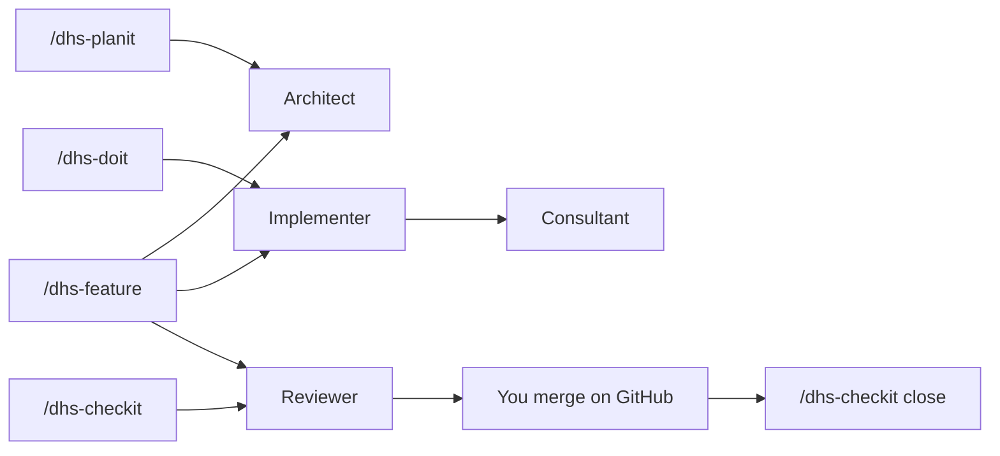
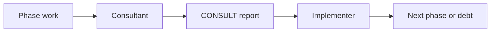
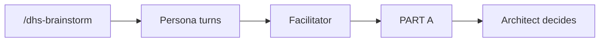

# dhs

A layer for software engineering work in an AI coding assistant. Supported hosts in this version are **Claude Code** and **Cursor Agent**. It ships **skills**, **agents**, **rule packs**, and a **small CLI** so a project can specify, implement (with a quality loop), and review work without each agent inventing its own process.

One path: request → spec → implementation with quality feedback → review against the spec.

The product and CLI binary are **`dhs`**. The npm package is **`dev-harness-layer`**. Contracts in full: [`docs/prd.md`](docs/prd.md).

## Requirements

- Node.js 18 or later
- Run commands in **this project’s directory**, with the assistant open on that project
- Do **not** `npm install -g`
- Do **not** install skills, templates, or a CLI into `~/.claude/`, `~/.cursor/`, or any other machine-wide path
- Git helpers need `sh` (Windows is out of v1)

## Hosts

A **host** is the coding assistant (harness) you run dhs in. This version: **Claude Code** and **Cursor Agent**. A later host is a row in `hosts.json` plus a format adapter, not a second product.

`dhs install` and `/dhs-setup` always write **every** row in `.dhs/references/hosts.json`. They do not ask which hosts to use. Live skills, agents, rules, and brainstorm files are **copies** (not symlinks to `.dhs/agents/`) under `.claude/` and `.cursor/` (rules as `.md` vs `.mdc`). In a session, use the copy that host loaded. Skill bodies match; live agent `model:` is that host’s string only.

### Models per host

`agents.roles.<role>.model` is a map keyed by host `id`, not one string per role:

```text
"architect": { "model": { "claude-code": "opus", "cursor": "inherit" } }
```

First-run suggestions come from that host row’s `modelSuggest`. dhs does not translate a Claude alias into a Cursor id.

| Host | Architect | Implementer | Consultant | Reviewer |
|------|-----------|-------------|------------|----------|
| Claude Code | `opus` | `sonnet` | `haiku` | `sonnet` |
| Cursor | `inherit` | `inherit` | `inherit` | `inherit` |

A later `/dhs-setup` model change is one cell `(role, host)` and rewrites `model:` only in that host’s `agentsDir`. If `model` is still a string, or a host `id` is missing, setup finishes the map first (prefill a legacy string on every host, then confirm per host) before it stamps live files.

Brainstorm uses the same map shape on `agents.brainstorm.model`. `/dhs-brainstorm` asks one model per host on the first member (not `/dhs-setup`): that string is for every persona turn **and** the facilitator. No per-persona model.

## 1. Install

From the project directory, pick one source and reuse it later for uninstall:

```text
npx -p dev-harness-layer dhs install
npx -p github:nbmh/dev-harness-layer dhs install
npx -p github:nbmh/dev-harness-layer#<ref> dhs install
npx -p https://github.com/nbmh/dev-harness-layer dhs install
```

npm and GitHub are equivalent. `#<ref>` is an optional tag, branch, or commit.

**Result:** `.dhs/` and the project skill `/dhs-setup` in every host `skillsDir` (today `.claude/skills/dhs-setup` and `.cursor/skills/dhs-setup`). Setup is **not** done. Work skills (`/dhs-feature`, `/dhs-planit`, `/dhs-doit`, `/dhs-checkit`, `/dhs-brainstorm`) do not exist yet.

## 2. Setup

In the assistant, run **`/dhs-setup`**. That is the only way to finish first-time setup. The CLI does not configure the project.

First run asks one question at a time (role models **per host**, content language, base git branch, optional project rule, Jira). It does not commit.

**Required result:** a project PRD, `harness.config.json`, live agents, remaining skills, and rule packs in **every** host tree, plus a project-root `AGENTS.md`.

Until `harness.config.json` exists, and whenever `.dhs/VERSION` does not match `dhs.generatedFrom`, work skills stop and tell you to run `/dhs-setup`.

First run, later changes, and what you can set: [`/dhs-setup`](#dhs-setup).

## 3. Work

Say what you want in ordinary language. The assistant matches **intent** to a skill; slash names (`/dhs-feature`, and so on) label the skill in the host, they are not a command line to assemble.

| Intent | Skill |
|--------|---------|
| Full path | `/dhs-feature` |
| Spec only | `/dhs-planit` |
| Implementation only | `/dhs-doit` |
| One review / update from base / close after merge | `/dhs-checkit` |
| Change parameters or Jira | `/dhs-setup` |
| Personae | `/dhs-brainstorm` |

You merge the GitHub PR. Close is `/dhs-checkit` after you confirm the merge.

## 4. Uninstall (optional)

Same source as install:

```text
npx -p dev-harness-layer dhs uninstall
npx -p github:nbmh/dev-harness-layer dhs uninstall
```

Removes `.dhs/` and the install-owned `/dhs-setup` skill from every `skillsDir`. Leaves `harness.config.json` and files `/dhs-setup` already generated (live agents, work skills, rules).

## After a package update

Run install again from the same source, then `/dhs-setup`, so generated files match the installed templates (`.dhs/VERSION` vs `dhs.generatedFrom`).

## Skills

Consultant is **not** a slash skill. The Implementer launches it. Single-stage skills do not chain; only `/dhs-feature` runs the full path.

If Architect needs a persona round, work skills **stop and ask** `/dhs-brainstorm`. `/dhs-feature` does not run that round itself.

| Skill | When | What happens | Example |
|-------|------|----------------|---------|
| `/dhs-setup` | First config; later models, packs, base branch, Jira | One question at a time; generate live files; does not commit. See [`/dhs-setup`](#dhs-setup). | "change the architect model" · "change the architect model on Cursor" · "connect Jira" |
| `/dhs-planit` | Spec only | Architect once; offer next step; **do not start it** | "write a spec for login" · "tighten the spec for 001-login" · "spec PROJ-12" |
| `/dhs-doit` | Spec and prompt already exist | Implementer + Consultant loop; status stays `in progress` | "implement 001-login" · "implement PROJ-12" |
| `/dhs-checkit` | One Reviewer round | Variants: review (default), update from base, close after **you** confirm merge | "review this" · "update this branch from base" · "the PR is merged, close the task" |
| `/dhs-feature` | Full path | Starts at the first missing stage; does not merge | "add password reset from spec through PR" |
| `/dhs-brainstorm` | Personae | CRUD members, app context, consult round; does not role-play. See [Brainstorm](#brainstorm). | "consult this spec with the personae" · "build the app context" |



## /dhs-setup

The only way to configure this project. The CLI does not write config. Questions are **one at a time**. The skill does not commit.

If `harness.config.json` is missing, that is a **first run**. If the file is already there, that is a **later run** — the same skill, not a second command.

```text
"change the architect model" · "change the architect model on Cursor" · "connect Jira" · "change the base branch"
```

### First run

1. Reads the repo and states inferred choices so you can object.
2. **Project PRD.** Uses an existing one and does not rewrite it. If none exists, gathers from the repo, asks only for facts the repo does not contain, then writes `docs/prd.md`. Config stores a one-line product plus `agents.docs`, not the PRD body.
3. **Questions** (before it writes config): for each host, then for each of the four roles, one model (suggest that host’s `modelSuggest`; see [Models per host](#models-per-host)); `agents.contentLanguage`; `agents.baseBranch` (suggest `dev` — it does not silently take `main`, `master`, or the current checkout); one optional **project rule** (a standing instruction beyond generated packs; skip is the default); which packs to generate (`packsIgnored` if you name packs to skip).
4. Writes `harness.config.json` (`dhs.generatedFrom` = `.dhs/VERSION`) and generates live agents, work skills, and rule packs from `.dhs/` into **every** host tree. Each live agent’s `model:` is `agents.roles.<role>.model[<host.id>]` only.
5. Merges project-root `AGENTS.md` and/or `CLAUDE.md` with the dhs template, shows the full proposed markdown, and waits for acceptance. The result is always `AGENTS.md`. It writes `CLAUDE.md` only when `.claude/` was present and/or `CLAUDE.md` already existed (prefer a symlink to `AGENTS.md`; if the link fails, an independent file with the same body).
6. Offers Jira **once**. A decline is stored; add, change, or remove later is this same skill.

### Later run

Config already exists. Say what to change in ordinary language.

If a role `model` is still a string, or the map is missing a host `id`, it finishes that map first (prefill a legacy string on every host, then confirm per host). If `.dhs/VERSION` does not match `dhs.generatedFrom`, it first regenerates live agents, work skills, and rule packs into every host tree, sets `dhs.generatedFrom` to `.dhs/VERSION`, and tells you the installed package templates changed — then continues. That is the same mechanism as [After a package update](#after-a-package-update).

Then **one change at a time**: show current and new value, wait for confirmation, then write. It does not overwrite keys you did not confirm. A role `model` change is one cell `(role, host)` and rewrites `model:` in **that** host’s `agentsDir` only.

It does **not** touch `agents.brainstorm` (that is `/dhs-brainstorm`), rewrite the project PRD, remake or re-merge `AGENTS.md`, or commit. If `.claude/` is present and `CLAUDE.md` is still missing, it creates the symlink the same way as on first run.

### What you can set or change

| Setting | First run | Later run | Side effect |
|---------|-----------|-----------|-------------|
| Role models | ask per host | yes — one cell `(role, host)` | rewrite `model:` in that host’s `agentsDir` |
| `agents.contentLanguage` | ask | yes | config only |
| `agents.baseBranch` | ask | yes | config only |
| Optional project rule | one; skip is default | if you ask — stored on the roles (`rules`; reviewer `checklist` when it is a review constraint) | stored on roles |
| Packs / `packsIgnored` | detect; honour ignore | yes | regenerate rule packs |
| Status strings | skeleton unless you confirm other strings | yes | config only |
| Product line / `agents.docs` | from the PRD step | yes | config only |
| Jira tracker | offer once: add or decline | add / change mapping / remove | config + local credentials file; no agent-body regen |
| Project PRD | create only if missing | no rewrite | — |
| `AGENTS.md` | merge + accept | no remake | later: only create missing `CLAUDE.md` if `.claude/` exists |
| Brainstorm members / model / consult | no | no | `/dhs-brainstorm` |

**Jira.** Add asks URL, user, and project key (one at a time). You put the token in a project-local ignored credentials file — never in chat, git, or `harness.config.json`. Then map each status `todo` → `done` (or skip = `null`), where spec and prompt live, and issue types for `feature` and `bug`. Change keeps the token unless you rotate it in that file. Remove drops the tracker; the project is files-only again. Switching trackers does not migrate old tasks.

## Agents

Exactly four product agents. Brainstorm members are not agents and are not `@`-addressable. Interview defaults depend on the host (see [Models per host](#models-per-host)); config stores a map, not one string per role.

| Agent | Job | Must not |
|-------|-----|----------|
| **Architect** | Spec + prompt + first log row on the **active tracker**. Status stays `todo`. Read-only on application code. | Write app code; git; a file-by-file recipe |
| **Implementer** | Implements the spec (`feature` or `bug`). Own 2–6 phase plan. After each phase, launches Consultant. Calls `.dhs/scripts/start-task`. | Edit `CHANGELOG.md`; open the PR; invent architecture past Questions |
| **Consultant** | Code **quality** on the **phase diff**. Structured `CONSULT` report. Not a user skill. | Edit product code; talk to the user; judge spec compliance |
| **Reviewer** | Spec compliance (requirements + acceptance criteria) only. After acceptance: changelog, commit, push, PR, return to base. | Merge the PR; treat Consultant `should-fix` as ❌ |

### Architect

Writes the spec, the implementation prompt, and the first log row. Status stays `todo`; the Implementer moves it later. Read-only on application code; no git writes.

If a persona round is needed, Architect **stops and asks** `/dhs-brainstorm`. It does not interview personae itself. When that skill returns **PART A**, Architect decides on every blocker, conflict, and gap, then continues the spec. Details: [Brainstorm](#brainstorm).

### Implementer and Consultant

Consultant is **not** a slash skill. The Implementer launches it after **each** phase so cheap quality feedback happens during implementation, and Reviewer can stay spec-only.

The Implementer plans 2–6 coherent phases (a slice of behaviour, not one file), runs `.dhs/scripts/start-task`, sets status `in progress`, and does the work. After a phase:

```text
phase work → Consultant pass 1
  no must-fix → next phase
  must-fix    → Implementer fixes only those ids → Consultant pass 2
                  closed → next phase
                  still open → debt protocol, then continue
```



Consultant reads the **phase diff**, touched files, generated rules, and tests for those files. It returns a structured report: `must-fix` can block the phase; `should-fix` never blocks (Implementer may apply or skip; skipped items get one log line); `notes` never block.

Consultant never talks to the user. In interactive mode, if `must-fix` is still open after pass 2, the **Implementer** asks whether to grant one extra pass or accept debt. Caps, stale findings, and the full report shape: [`docs/prd.md`](docs/prd.md) (Agents / Consultant).

### Reviewer

A different axis from Consultant: **does this match the spec** (requirements + acceptance criteria), not how the code is written. Leftover Consultant `should-fix` is not ❌. Leftover `must-fix` may be ❌ only when it actually misses an acceptance criterion.

First review while `in progress` sets `code review`. ❌ goes back to the Implementer with those items only. After acceptance: changelog, commit, push, PR, return to base. You merge on GitHub. Max three Reviewer rounds.

## Brainstorm

Optional extra viewpoints while specifying. Members are markdown **personae**, not dhs roles and not `@`-targets. The skill orchestrates; it does not role-play.

There is still a **facilitator**, but it is not a fifth product agent: no model in `agents.roles`, no `/dhs-setup` question. It is an isolated collector. Implementer, Consultant, and Reviewer never run a round. `/dhs-setup` does not edit members.



### Personae and how you manage them

CRUD is **only** `/dhs-brainstorm`. Config lives in `agents.brainstorm.members`: `id`, `description`, `identity`, `cares`, `dislikes`. Live files are `<brainstormDir>/members/<id>.md` for **every** `brainstormDir` in `.dhs/references/hosts.json`, generated from the template. After create, edit, or remove, regenerate that file from config. Do not hand-edit generated member markdown.

On the **first** member in a project, the skill also asks (once):

- Consult threshold: `any` (every user-visible change) / `significant` (default — hard to reverse, or changes how the product is used) / `broad` (new module, onboarding, pricing, navigation rebuild). Written as `agents.brainstorm.consult`.
- One model **per host** for every persona turn **and** the facilitator (suggest that host’s `modelSuggest.brainstorm`). No per-persona model. Written as `agents.brainstorm.model` (a map keyed by host `id`). A legacy string is migrated the same way as role models.

**App context** is `<brainstormDir>/app-context.md` in every `brainstormDir`, built from the repo (product line, `agents.docs`, README). Gaps: one question at a time; write only after you confirm the file. A consult without a ready app context stops.

### How a round collects opinions

Isolation is the point. Personae must not see Architect notes, `Q<n>` leanings, each other, or a “corrected” spec.

```text
material (spec or question)
    → each persona, alone, without Architect context
    → facilitator collates, without scoring or picking a winner
    → Architect receives PART A and decides
```

1. Ready app context (or stop and finish it).
2. **Persona turns.** Isolated one-shot per member, in parallel when the runtime allows. Each sees: their member file, the output format, app context, and the material. Read only. No git. No spec edits.
3. Each persona answers in a fixed shape: needs and barriers marked `[BLOCKER]` / `[IMPORTANT]` / `[NICE]`, facts vs assumptions, a short use scene, confidence. They do not propose a technical implementation.
4. **Facilitator** (two or more members): isolated one-shot that **only collects** PART A — shared points, conflicts, blockers, lone voices, review quality. It does not decide who is right, drop a lone blocker, or average. One member → that reply **is** PART A; skip the facilitator.
5. **Architect** with **PART A only** plus the material. Do not pass persona transcripts.

Do not paste transcripts back into the chat or into the Architect launch. If every persona says almost the same thing, that is a weak set — the facilitator flags it under review quality. One round unless you ask for another, and then only for what changed.

### Two ways in

**Direct consult** (`/dhs-brainstorm` plus a question or a spec). Needs a ready app context and at least one member. The consult threshold does **not** apply. If you name members, those are asked; otherwise every member. The skill runs personae → facilitator → Architect, then **shows the Architect’s decisions** (not the raw persona replies). You resolve leftover conflicts. A blocker the Architect rejected is still shown.

**During specification** (`/dhs-planit`, or Architect inside `/dhs-feature`). If Architect needs a round, work skills **stop and ask** `/dhs-brainstorm`. They do not interview personae in-process. `/dhs-feature` does not start a round by itself.

A round **on its own** (nobody named a question) runs only when there are at least **two** members **and** the work passes `agents.brainstorm.consult` (`any` / `significant` / `broad` as above).

### How Architect uses PART A

Architect decides on every blocker, conflict, and gap. Agreement among personae is not required and is not proof. A persona opinion is not user approval.

**Interactive:** after you confirm the round, the skill writes `docs/brainstorm/<slug>-<YYYY-MM-DD>.md`. That settled record is Accepted / Left for the user only — no persona replies, no PART A. **Critical / autonomous:** Architect consumes PART A and does **not** write that file.

Settled records stay files under `docs/brainstorm/`. They are not the task tracker.

## Modes

Two axes. Do not mix them.

### Interaction

From **intent**, not a required slash flag. Default: `interactive`. You may name the mode in the request so every agent in a `/dhs-feature` run shares it; you do not assemble it like a CLI flag.

| Mode | Ask the user |
|------|----------------|
| `interactive` | One `Q<n>` at a time, when it is reached. Architect confirms title, then spec+prompt, before write. Reviewer waits for explicit acceptance before changelog, commit, or PR. |
| `critical` | One question only for a **critical** decision, then stop. Otherwise decide, record one sentence, continue. Clean review = PR URL; do not merge. |
| `autonomous` | Ask nothing. Contradictions follow the existing spec, or the latest explicit sentence of the request. Preserve user data. Record each choice. Same acceptance as `critical`. |

A decision is **critical** when the request contradicts itself or an existing spec and the two readings ship different behaviour; the work needs a new dependency or external service; it would delete or overwrite user data or be hard to undo in production; or a missing fact would ship two different behaviours.

```text
"add export to CSV" → interactive (default)
"add export to CSV and don't ask me" → autonomous
"tighten the login spec; only stop me for critical decisions" → critical
```

Consultant never talks to the user; the Implementer does, if the debt protocol requires it.

### Reviewer variants

Not interaction modes. `/dhs-checkit` runs **one** of: `review` (default) | `update` | `close`.

## Trackers and statuses

**Exactly one tracker:** files **or** Jira, never both. Agents do not mirror. Switching does not migrate leftover files or tickets.

**Files (default).** One task = three files, same basename (example `001-feature-example-name`):

| Path | Role |
|------|------|
| `docs/features/<basename>.feature.md` | Spec |
| `docs/prompt/<basename>.prompt.md` | Implementation prompt |
| `docs/feature-log/<basename>.log.md` | Append-only log |

Task key = basename. Branch name = basename.

**Jira.** Task key = issue key (`PROJ-123`). Branch name = that key. Spec, prompt, log, and status live **only** on the ticket. `/dhs-setup` maps which Jira status each step uses. Credentials stay out of git and out of chat.

Same artifact shape on both: spec (abstract, requirements, acceptance criteria, architectural decisions — choices and why, not a tutorial), prompt (phase-grain order, what not to change; the Implementer still writes their own plan), log (`Q<n>` decisions, `C<id>` Consultant items).

```text
todo → in progress → code review → in review → done
```

| Status | Meaning | Who may run |
|--------|---------|-------------|
| `todo` | Spec and prompt exist or are being written. Architect does not advance past this. | Architect; then Implementer |
| `in progress` | Implementation + Consultant loop. | Implementer (+ Consultant, launched by them) |
| `code review` | Implementation finished; Reviewer working or open ❌. | Reviewer; fix round → Implementer |
| `in review` | Clean review accepted: commit + push + PR. Waiting for merge. | Reviewer: update-from-base or close |
| `done` | PR merged to the base branch and confirmed. | None |

You merge on GitHub. Close is `/dhs-checkit` after you confirm.

## Rule packs

`/dhs-setup` generates short, path-scoped coding rules from detected frameworks. They are not always-on essay markdown. Ignore packs with `packsIgnored`. First setup may also record **one** optional project rule (a standing instruction beyond packs).

| Pack | Typical detection |
|------|-------------------|
| `javascript` | JS without TypeScript as primary |
| `typescript` | `tsconfig` / TypeScript sources |
| `react-native` | React Native / Expo |
| `angular` | Angular |
| `nextjs` | Next.js |
| `python` | Python project files |
| `django` | Django |
| `fastapi` | FastAPI |

## Git and language

Base branch is `agents.baseBranch` (first setup; suggested default `dev`). Scripts do not guess `main`, `master`, or the current checkout.

Allowlisted git/`gh` goes through `.dhs/scripts/` only: `start-task`, `commit-task`, `push-task`, `open-pr`, `update-from-base`, `return-to-base`. No rebase, reset, or force. dhs does not merge the PR.

Replies follow the conversation language. Spec, prompt, log, changelog, and PR text follow `agents.contentLanguage` from config. Status strings stay as configured; do not translate them from the conversation.

## CLI

v1 CLI is only `dhs install` and `dhs uninstall`. Everything else is a skill. Install and uninstall loop every host in the **package** `hosts.json` (uninstall still works after `.dhs/` is gone).

No extra product agents. No worktrees. No Linear or GitHub Issues as a tracker. No merging pull requests.
