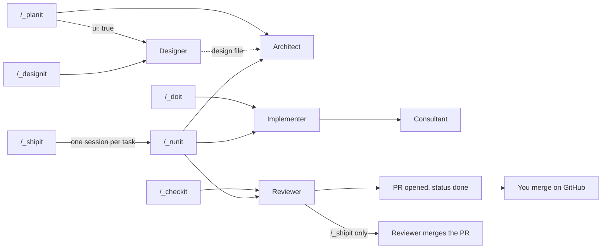

# SE Harness

**SE Harness** is a software engineering (SE) layer for an AI coding assistant. Supported hosts in this version are **Claude Code**, **Cursor Agent**, **OpenCode**, and **Codex**. It ships **skills**, **agents**, **rule packs**, and a **small CLI** so a project can specify, implement (with a quality loop), and review work without each agent inventing its own process.

One path: request → spec → implementation with quality feedback → review against the spec.

The CLI binary is **`seh`**. The npm package is **`se-harness`**. Contracts in full: [`docs/prd.md`](docs/prd.md).

## Requirements

- Node.js 18 or later
- Run commands in **this project’s directory**, with the assistant open on that project
- Do **not** `npm install -g`
- Do **not** install skills, templates, or a CLI into `~/.claude/`, `~/.cursor/`, `~/.config/opencode/`, `~/.codex/`, or any other machine-wide path
- Git helpers need `sh` (Windows is out of v1)
- Git is optional: an empty `agents.baseBranch` turns it off (see [Git and language](docs/guide/setup.md#git-and-language))

## Quick start

### 1. Install

From the project directory:

```bash
npx se-harness install
```

Or straight from GitHub (same result; `#<ref>` is an optional tag, branch, or commit):

```bash
npx github:meehow-halas/se-harness install
```

```bash
npx github:meehow-halas/se-harness#<ref> install
```

This writes `.seh/` and the `/_setit-se` skill. A custom skill prefix (`--prefix`) and more sources: [Install and setup](docs/guide/setup.md#install).

### 2. Setup

In the assistant, ask for setup (**`/_setit-se`**). It asks one question at a time (role models per host, content language, base git branch, optional project rule, Jira or Azure DevOps), then writes `harness.config.json`, a project PRD, live agents, work skills, and rule packs in every host tree, plus `AGENTS.md`. It does not commit. The CLI does not configure the project.

Work skills stop and ask you to set up first (`/_setit-se`) until setup is done, and again after a package update. Details: [`/_setit-se`](docs/guide/setup.md#_setit-se).

### 3. Work

Say what you want in ordinary language. The assistant matches **intent** to a skill; slash names label the skill in the host, they are not a command line to assemble.

| Intent | Skill |
|--------|---------|
| Full path for one task (several keys: one session each) | `/_runit` |
| Many specced tasks to merged, in dependency order, unattended | `/_shipit` |
| Spec only | `/_planit` |
| UX/UI design only, before the spec | `/_designit` |
| Implementation only | `/_doit` (one task or a list) |
| One review | `/_checkit` (one task or a list) |
| Change parameters or tracker (Jira / Azure DevOps) | `/_setit-se` |
| Project PRD (create or update) | `/_scopeit` |
| Personae | `/_grillit` |

After you accept a clean review, the Reviewer commits, opens the PR and sets `done`. That ends the feature. You merge the PR on GitHub; nothing else is needed from SE Harness. The one exception is `/_shipit`: its sessions merge their own PRs.



Whole runs step by step, from a single `/_doit` to an overnight `/_shipit`: [Example runs](docs/guide/examples.md).

## Guide

- **[Example runs](docs/guide/examples.md).** What you can ask SE Harness to do and what happens then, simple runs first.
- **[Install and setup](docs/guide/setup.md).** Install sources and `--prefix`, everything `/_setit-se` asks and changes, package updates, uninstall, rule packs, git worktrees and language.
- **[Git worktrees](docs/guide/worktrees.md).** Where each task's worktree lives, when it is created and removed, when it stays, and manual cleanup.
- **[Skills, agents, and modes](docs/guide/workflow.md).** What each skill does, the five agents (Architect, Designer, Implementer, Consultant, Reviewer), and the `interactive` / `critical` / `autonomous` modes.
- **[Trackers and statuses](docs/guide/trackers.md).** One active tracker: repo files (default), Jira, or Azure DevOps, with a switch per tracker write. Credentials, field mapping, and the `todo → in progress → implemented → in review → done` statuses.
- **[Brainstorm](docs/guide/brainstorm.md).** Optional personae that comment on a spec in isolation through `/_grillit`; the Architect decides.
- **[Hosts](docs/guide/hosts.md).** How Claude Code, Cursor, OpenCode, and Codex differ, and the role model map per host.

## Update and uninstall

After a package update, run install again from the same source, then ask for setup (`/_setit-se`):

```bash
npx se-harness@latest install
```

Uninstall (same source as install) removes `.seh/` and the `/_setit-se` skill, and leaves config and generated files:

```bash
npx se-harness uninstall
```

Pinning, forced regeneration, and what uninstall leaves behind: [Install and setup](docs/guide/setup.md#after-a-package-update).

## CLI

v1 CLI is only `seh install [--prefix P]` and `seh uninstall`. Everything else is a skill. Install and uninstall loop every host in the **package** `hosts.json` (uninstall still works after `.seh/` is gone).

No extra product agents. No Linear or GitHub Issues as a tracker (files, Jira, Azure DevOps only). No merging pull requests outside `/_shipit`.
