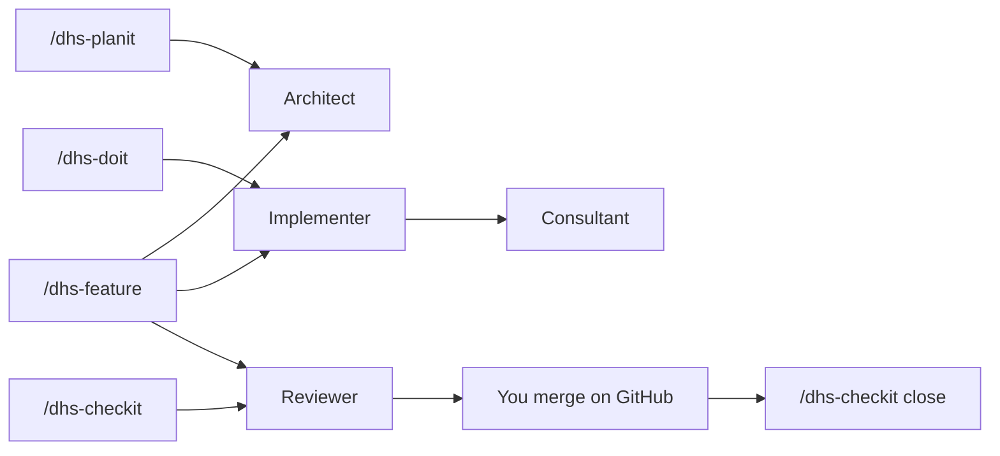

# dhs

A layer for software engineering work in an AI coding assistant (Claude Code first). It ships **skills**, **agents**, **rule packs**, and a **small CLI** so a project can specify, implement (with a quality loop), and review work without each agent inventing its own process.

One path: request → spec → implementation with quality feedback → review against the spec.

The product and CLI binary are **`dhs`**. The npm package is **`dev-harness-layer`**. Contracts in full: [`docs/prd.md`](docs/prd.md).

## Requirements

- Node.js 18 or later
- Run commands in **this project’s directory**, with the assistant open on that project
- Do **not** `npm install -g`
- Do **not** install skills, templates, or a CLI into `~/.claude/` or any other machine-wide path
- Git helpers need `sh` (Windows is out of v1)

## 1. Install

From the project directory, pick one source and reuse it later for uninstall:

```text
npx -p dev-harness-layer dhs install
npx -p github:nbmh/dev-harness-layer dhs install
npx -p github:nbmh/dev-harness-layer#<ref> dhs install
npx -p https://github.com/nbmh/dev-harness-layer dhs install
```

npm and GitHub are equivalent. `#<ref>` is an optional tag, branch, or commit.

**Result:** `.dhs/` and the project skill `/dhs-setup`. Setup is **not** done. Work skills (`/dhs-feature`, `/dhs-planit`, `/dhs-doit`, `/dhs-checkit`, `/dhs-brainstorm`) do not exist yet.

## 2. Setup

In the assistant, run **`/dhs-setup`**. That is the only way to finish first-time setup. The CLI does not configure the project.

First run asks one question at a time (role models, content language, base git branch, optional project rule, Jira). It does not commit.

**Required result:** a project PRD, `harness.config.json`, live agents, the remaining skills, rule packs, and a project-root `AGENTS.md`.

Until `harness.config.json` exists, and whenever `.dhs/VERSION` does not match `dhs.generatedFrom`, work skills stop and tell you to run `/dhs-setup`.

## 3. Work

| Intent | Command |
|--------|---------|
| Full path | `/dhs-feature` plus what to build |
| Spec only | `/dhs-planit` |
| Implementation only | `/dhs-doit` |
| One review / update from base / close after merge | `/dhs-checkit` |
| Change parameters or Jira | `/dhs-setup` |
| Personae | `/dhs-brainstorm` |

You merge the GitHub PR. Close is `/dhs-checkit` after you confirm the merge.

## 4. Uninstall (optional)

Same source as install:

```text
npx -p dev-harness-layer dhs uninstall
npx -p github:nbmh/dev-harness-layer dhs uninstall
```

Removes `.dhs/` and the install-owned `/dhs-setup` skill. Leaves `harness.config.json` and files `/dhs-setup` already generated.

## After a package update

Run install again from the same source, then `/dhs-setup`, so generated files match the installed templates (`.dhs/VERSION` vs `dhs.generatedFrom`).

## Skills

Consultant is **not** a slash skill. The Implementer launches it. Single-stage skills do not chain; only `/dhs-feature` runs the full path.

If Architect needs a persona round, work skills **stop and ask** `/dhs-brainstorm`. `/dhs-feature` does not run that round itself.

| Skill | When | What happens | Example |
|-------|------|----------------|---------|
| `/dhs-setup` | First config; later models, packs, base branch, Jira | One question at a time; generate live files; does not commit | `/dhs-setup` · change architect model · add Jira |
| `/dhs-planit` | Spec only | Architect once; offer next step; **do not start it** | `/dhs-planit add login` · `/dhs-planit 001-login` · `/dhs-planit PROJ-12` |
| `/dhs-doit` | Spec and prompt already exist | Implementer + Consultant loop; status stays `in progress` | `/dhs-doit 001-login` · `/dhs-doit PROJ-12` |
| `/dhs-checkit` | One Reviewer round | Variants: review (default), update from base, close after **you** confirm merge | `/dhs-checkit` · `/dhs-checkit update` · `/dhs-checkit close` |
| `/dhs-feature` | Full path | Starts at the first missing stage; does not merge | `/dhs-feature add password reset` |
| `/dhs-brainstorm` | Personae | CRUD members, app context, consult round; does not role-play | `/dhs-brainstorm` · consult this spec · build app context |



## Agents

Exactly four product agents. Brainstorm members are not agents and are not `@`-addressable. Default models: Architect opus, Implementer sonnet, Consultant haiku, Reviewer sonnet.

| Agent | Job | Must not |
|-------|-----|----------|
| **Architect** | Spec + prompt + first log row on the **active tracker**. Status stays `todo`. Read-only on application code. | Write app code; git; a file-by-file recipe |
| **Implementer** | Implements the spec (`feature` or `bug`). Own 2–6 phase plan. After each phase, launches Consultant. Calls `.dhs/scripts/start-task`. | Edit `CHANGELOG.md`; open the PR; invent architecture past Questions |
| **Consultant** | Code **quality** on the **phase diff**. Structured `CONSULT` report. Not a user skill. | Edit product code; talk to the user; judge spec compliance |
| **Reviewer** | Spec compliance (requirements + acceptance criteria) only. After acceptance: changelog, commit, push, PR, return to base. | Merge the PR; treat Consultant `should-fix` as ❌ |

**Quality loop (required).** After each phase: Consultant pass 1 → fix `must-fix` → pass 2 → else log debt and continue. Caps: 2 passes per phase, 6 phases per task, 8 Consultant launches per task. Reviewer: max three rounds. Debt protocol and report shape: [`docs/prd.md`](docs/prd.md).

## Modes

Two axes. Do not mix them.

### Interaction

From **intent**, not a required slash flag. Default: `interactive`. A `/dhs-feature` launch may name the mode so every agent in that run shares it.

| Mode | Ask the user |
|------|----------------|
| `interactive` | One `Q<n>` at a time, when it is reached. Architect confirms title, then spec+prompt, before write. Reviewer waits for explicit acceptance before changelog, commit, or PR. |
| `critical` | One question only for a **critical** decision, then stop. Otherwise decide, record one sentence, continue. Clean review = PR URL; do not merge. |
| `autonomous` | Ask nothing. Contradictions follow the existing spec, or the latest explicit sentence of the request. Preserve user data. Record each choice. Same acceptance as `critical`. |

A decision is **critical** when the request contradicts itself or an existing spec and the two readings ship different behaviour; the work needs a new dependency or external service; it would delete or overwrite user data or be hard to undo in production; or a missing fact would ship two different behaviours.

```text
/dhs-feature add export to CSV
/dhs-feature autonomous add export to CSV
/dhs-planit critical tighten the login spec
```

Consultant never talks to the user; the Implementer does, if the debt protocol requires it.

### Reviewer variants

Not interaction modes. `/dhs-checkit` runs **one** of: `review` (default) | `update` | `close`.

## Trackers and statuses

**Exactly one tracker:** files **or** Jira, never both. Agents do not mirror. Switching does not migrate leftover files or tickets.

**Files (default).** One task = three files, same basename (example `001-feature-example-name`):

| Path | Role |
|------|------|
| `docs/features/<basename>.feature.md` | Spec |
| `docs/prompt/<basename>.prompt.md` | Implementation prompt |
| `docs/feature-log/<basename>.log.md` | Append-only log |

Task key = basename. Branch name = basename.

**Jira.** Task key = issue key (`PROJ-123`). Branch name = that key. Spec, prompt, log, and status live **only** on the ticket. `/dhs-setup` maps which Jira status each step uses. Credentials stay out of git and out of chat.

Same artifact shape on both: spec (abstract, requirements, acceptance criteria, architectural decisions — choices and why, not a tutorial), prompt (phase-grain order, what not to change; the Implementer still writes their own plan), log (`Q<n>` decisions, `C<id>` Consultant items).

```text
todo → in progress → code review → in review → done
```

| Status | Meaning | Who may run |
|--------|---------|-------------|
| `todo` | Spec and prompt exist or are being written. Architect does not advance past this. | Architect; then Implementer |
| `in progress` | Implementation + Consultant loop. | Implementer (+ Consultant, launched by them) |
| `code review` | Implementation finished; Reviewer working or open ❌. | Reviewer; fix round → Implementer |
| `in review` | Clean review accepted: commit + push + PR. Waiting for merge. | Reviewer: update-from-base or close |
| `done` | PR merged to the base branch and confirmed. | None |

You merge on GitHub. Close is `/dhs-checkit` after you confirm.

## Rule packs

`/dhs-setup` generates short, path-scoped coding rules from detected frameworks. They are not always-on essay markdown. Ignore packs with `packsIgnored`. First setup may also record **one** optional project rule (a standing instruction beyond packs).

| Pack | Typical detection |
|------|-------------------|
| `javascript` | JS without TypeScript as primary |
| `typescript` | `tsconfig` / TypeScript sources |
| `react-native` | React Native / Expo |
| `angular` | Angular |
| `nextjs` | Next.js |
| `python` | Python project files |
| `django` | Django |
| `fastapi` | FastAPI |

## Git and language

Base branch is `agents.baseBranch` (first setup; suggested default `dev`). Scripts do not guess `main`, `master`, or the current checkout.

Allowlisted git/`gh` goes through `.dhs/scripts/` only: `start-task`, `commit-task`, `push-task`, `open-pr`, `update-from-base`, `return-to-base`. No rebase, reset, or force. dhs does not merge the PR.

Replies follow the conversation language. Spec, prompt, log, changelog, and PR text follow `agents.contentLanguage` from config. Status strings stay as configured; do not translate them from the conversation.

## CLI

v1 CLI is only `dhs install` and `dhs uninstall`. Everything else is a skill.

No `/dhs-init` or `/dhs-config`. No extra product agents. No worktrees. No Linear or GitHub Issues as a tracker. No merging pull requests.
