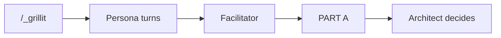

# Brainstorm

[← README](../../README.md) · Contracts in full: [`docs/prd.md`](../prd.md)

Optional extra viewpoints while specifying. Members are markdown **personae**, not seh roles and not `@`-targets. The skill orchestrates; it does not role-play.

There is still a **facilitator**, but it is not a sixth product agent: no model in `agents.roles`, no `/_setit-se` question. It is an isolated collector. Implementer, Consultant, and Reviewer never run a round. `/_setit-se` does not edit members.



## Personae and how you manage them

CRUD is **only** `/_grillit`. Config lives in `agents.brainstorm.members`: `id`, `description`, `identity`, `cares`, `dislikes`. Live files are `<brainstormDir>/members/<id>.md` for **every** `brainstormDir` in `.seh/references/hosts.json`, generated from the template. After create, edit, or remove, regenerate that file from config. Do not hand-edit generated member markdown.

On the **first** member in a project, the skill also asks (once):

- Consult threshold: `any` (every user-visible change) / `significant` (default — hard to reverse, or changes how the product is used) / `broad` (new module, onboarding, pricing, navigation rebuild). Written as `agents.brainstorm.consult`.
- One model **per host** for every persona turn **and** the facilitator (suggest that host’s `modelSuggest.brainstorm`). No per-persona model. Written as `agents.brainstorm.model` (a map keyed by host `id`). A legacy string is migrated the same way as role models.

**App context** is `<brainstormDir>/app-context.md` in every `brainstormDir`, built from the repo (product line, `agents.docs`, README). Gaps: one question at a time; write only after you confirm the file. A consult without a ready app context stops.

## How a round collects opinions

Isolation is the point. Personae must not see Architect notes, `Q<n>` leanings, each other, or a “corrected” spec.

```text
material (spec or question)
    → each persona, alone, without Architect context
    → facilitator collates, without scoring or picking a winner
    → Architect receives PART A and decides
```

1. Ready app context (or stop and finish it).
2. **Persona turns.** Isolated one-shot per member, in parallel when the runtime allows. Each sees: their member file, the output format, app context, and the material. Read only. No git. No spec edits.
3. Each persona answers in a fixed shape: needs and barriers marked `[BLOCKER]` / `[IMPORTANT]` / `[NICE]`, facts vs assumptions, a short use scene, confidence. They do not propose a technical implementation.
4. **Facilitator** (two or more members): isolated one-shot that **only collects** PART A — shared points, conflicts, blockers, lone voices, review quality. It does not decide who is right, drop a lone blocker, or average. One member → that reply **is** PART A; skip the facilitator.
5. **Architect** with **PART A only** plus the material. Do not pass persona transcripts.

Do not paste transcripts back into the chat or into the Architect launch. If every persona says almost the same thing, that is a weak set — the facilitator flags it under review quality. One round unless you ask for another, and then only for what changed.

## Two ways in

**Direct consult** (`/_grillit` plus a question or a spec). Needs a ready app context and at least one member. The consult threshold does **not** apply. If you name members, those are asked; otherwise every member. The skill runs personae → facilitator → Architect, then **shows the Architect’s decisions** (not the raw persona replies). You resolve leftover conflicts. A blocker the Architect rejected is still shown.

**During specification** (`/_planit`, or Architect inside `/_runit`). If Architect needs a round, work skills **stop and ask** `/_grillit`. They do not interview personae in-process. `/_runit` does not start a round by itself.

A round **on its own** (nobody named a question) runs only when there are at least **two** members **and** the work passes `agents.brainstorm.consult` (`any` / `significant` / `broad` as above).

## How Architect uses PART A

Architect decides on every blocker, conflict, and gap. Agreement among personae is not required and is not proof. A persona opinion is not user approval.

**Interactive:** after you confirm the round, the skill writes `docs/brainstorm/<slug>-<YYYY-MM-DD>.md`. That settled record is Accepted / Left for the user only — no persona replies, no PART A. **Critical / autonomous:** Architect consumes PART A and does **not** write that file.

Settled records stay files under `docs/brainstorm/`. They are not the task tracker.
