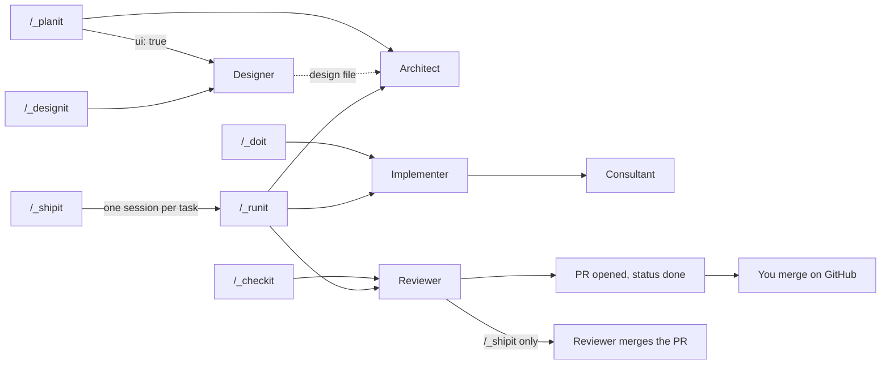
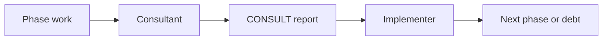

# Skills, agents, and modes

[← README](../../README.md) · Contracts in full: [`docs/prd.md`](../prd.md)

## Skills

Consultant is **not** a slash skill. The Implementer launches it. Single-stage skills do not chain; `/_runit` runs the full path for one task per session, and `/_shipit` runs many `/_runit` sessions to merged.

If Architect needs a persona round, work skills **stop and ask** `/_grillit`. `/_runit` does not run that round itself.

| Skill | When | What happens | Example |
|-------|------|----------------|---------|
| `/_setit-se` | First config; later models, packs, base branch, tracker | One question at a time; generate live files; does not commit. See [`/_setit-se`](setup.md#_setit-se). | "change the architect model" · "change the architect model on Cursor" · "connect Jira" · "connect Azure DevOps" |
| `/_planit` | Spec only | Architect once, then the Designer when the spec has `ui: true` and `agents.designer.enabled` is `true`; offer next step; **do not start it**. Optional: a design file from `/_designit` (path or slug) — the Architect takes the UX from it and the Designer stage is skipped | "write a spec for login" · "tighten the spec for 001-login" · "spec PROJ-12" · "spec login from docs/designs/login.design.md" |
| `/_designit` | UX/UI design only, before the spec | Designer once; writes `docs/designs/<slug>.design.md` in the repo (status `draft` → `ready`). No tracker, no spec, no git. Needs `agents.designer.enabled`. Offers `/_planit` or `/_runit` with the file; **does not start it**. Intent "learn conventions": the Designer scans the UI and writes `docs/designs/ux-conventions.md` instead (see [Designer](#agents)); offers nothing after it | "design the login screen" · "rework docs/designs/login.design.md" · "learn the project's UX conventions" |
| `/_doit` | Spec and prompt already exist | One task or a list. Parent runs `start-task` and launches Implementer per task with `Worktree:`. Several keys: one session per key (desktop app), or one after another in dependency order (git disabled). Ends with status `implemented` | "implement 001-login" · "implement 001-login and 002-logout" · "implement PROJ-12" |
| `/_checkit` | One Reviewer round per named task | Variants: review (default), update from base. One variant for the whole invocation; same worktree / parallel rules as `/_doit` | "review this" · "review 001-login and 002-logout" · "update this branch from base" |
| `/_runit` | Full path, one task per session | Architect → (Designer) → Implementer → Reviewer, starting at the first missing stage; does not merge. Optional design file as for `/_planit`. Several keys: one session each, no dependency ordering (a task that needs a sibling stops `BLOCKED`, rerun it later). Git disabled: one after another in dependency order | "add password reset from spec through PR" · "run MT-01 MT-02 MT-03 samodzielnie" |
| `/_shipit` | Many specced tasks to merged | Needs git and a spec + prompt per task. Asks once for a go-ahead, then one `/_runit` session per task with auto-merge; a dependent task starts after its dependency is merged. Writes a run report to `docs/run-reports/` | "ship MT-01 MT-02 MT-03 samodzielnie" · "ship all todo tasks" |
| `/_grillit` | Personae | CRUD members, app context, consult round; does not role-play. See [Brainstorm](brainstorm.md). | "consult this spec with the personae" · "build the app context" |



## Agents

Exactly five product agents. Brainstorm members are not agents and are not `@`-addressable. Interview defaults depend on the host (see [Models per host](hosts.md#models-per-host)); config stores a map, not one string per role.

| Agent | Job | Must not |
|-------|-----|----------|
| **Architect** | Spec + prompt + first log row on the **active tracker** (repo files when Jira or ADO is read-only). Status stays `todo`. Read-only on application code. No worktrees. | Write app code; git; a file-by-file recipe |
| **Designer** | Only for a spec with `ui: true` when `agents.designer.enabled` is `true`. Adds the **UX/UI decisions** section and `UX:` acceptance criteria to the spec, plus `D<n>` log rows. Same modes as the Architect. Through `/_designit`: writes one design file `docs/designs/<slug>.design.md` instead, with no tracker. Reads `docs/designs/ux-conventions.md` when it exists: it wins over the generic WCAG / HIG baseline in what it describes. `/_designit` "learn conventions" writes that file (about 50 rules with `path:line` evidence; `draft` → `ready`; deviations from `ux-a11y` only after you accept them). Read-only on application code; status unchanged. | Change requirements or Architect decisions; write app code; git |
| **Implementer** | Implements the spec (`feature` or `bug`). Own 2–6 phase plan. After each phase, launches Consultant. Calls `.seh/scripts/start-task` (worktree; does not switch your checkout). Works under `Worktree:`. | Edit `CHANGELOG.md`; open the PR; invent architecture past Questions |
| **Consultant** | Code **quality** on the **phase diff**. Structured `CONSULT` report. Not a user skill. | Edit product code; talk to the user; judge spec compliance |
| **Reviewer** | Spec compliance (requirements + acceptance criteria) only. After acceptance: changelog, commit, push, PR from the worktree. `return-to-base` **removes** that worktree; it does not switch your primary checkout. In a `/_shipit` session only: merges the PR through `merge-pr`. | Merge the PR outside `/_shipit`; treat Consultant `should-fix` as ❌ |

### Architect

Writes the spec, the implementation prompt, and the first log row. Status stays `todo`; the Implementer moves it later. With Jira or ADO in read-only mode, these go to repo files and the tracker is not written. Read-only on application code; no git writes; no worktrees.

If a persona round is needed, Architect **stops and asks** `/_grillit`. It does not interview personae itself. When that skill returns **PART A**, Architect decides on every blocker, conflict, and gap, then continues the spec. Details: [Brainstorm](brainstorm.md).

### Implementer and Consultant

Consultant is **not** a slash skill. The Implementer launches it after **each** phase so cheap quality feedback happens during implementation, and Reviewer can stay spec-only.

The Implementer plans 2–6 coherent phases (a slice of behaviour, not one file), runs `.seh/scripts/start-task` (git worktree; your primary checkout stays put), sets status `in progress`, and does the work under `Worktree:`. When all phases are done it sets `implemented`, which lets the Reviewer start. After a phase:

```text
phase work → Consultant pass 1
  no must-fix → next phase
  must-fix    → Implementer fixes only those ids → Consultant pass 2
                  closed → next phase
                  still open → debt protocol, then continue
```



Consultant reads the **phase diff**, touched files, generated rules, and tests for those files. It returns a structured report: `must-fix` can block the phase; `should-fix` never blocks (Implementer may apply or skip; skipped items get one log line); `notes` never block.

Consultant never talks to the user. In interactive mode, if `must-fix` is still open after pass 2, the **Implementer** asks whether to grant one extra pass or accept debt. Caps, stale findings, and the full report shape: [`docs/prd.md`](../prd.md) (Agents / Consultant).

### Reviewer

A different axis from Consultant: **does this match the spec** (requirements + acceptance criteria), not how the code is written. Leftover Consultant `should-fix` is not ❌. Leftover `must-fix` may be ❌ only when it actually misses an acceptance criterion.

The Reviewer starts from `implemented` (or from `in review` on a later round without a fix in between) and sets `in review`. ❌ sets `in progress` and sends those items back to the Implementer, who sets `implemented` again. After acceptance: changelog, `done`, commit, push, PR from the worktree; `return-to-base` removes that worktree. You merge on GitHub, except in `/_shipit`, where the Reviewer merges; on a conflict it merges the base in, resolves it, runs the project's checks, and retries (at most 3 attempts). Max three Reviewer rounds.

## Modes

Two axes. Do not mix them.

### Interaction

From **intent**, not a required slash flag. Default: `interactive`. Architect, Implementer, and Reviewer take `Mode:` on launch. `/_planit`, `/_doit`, and `/_checkit` pass that mode to the role they launch. You may name the mode in the request so every agent in a `/_runit` or `/_shipit` run shares it; you do not assemble it like a CLI flag. Consultant does not take `Mode:`.

| Mode | Ask the user |
|------|----------------|
| `interactive` | One `Q<n>` at a time, when it is reached. Architect confirms title, then spec+prompt, before write. Reviewer waits for explicit acceptance before changelog, commit, or PR. |
| `critical` | One question only for a **critical** decision, then stop. Otherwise decide, record one sentence, continue. Clean review = PR URL; do not merge. |
| `autonomous` | Ask nothing. Contradictions follow the existing spec, or the latest explicit sentence of the request. Preserve user data. Record each choice. Same acceptance as `critical`. |

A decision is **critical** when the request contradicts itself or an existing spec and the two readings ship different behaviour; the work needs a new dependency or external service; it would delete or overwrite user data or be hard to undo in production; or a missing fact would ship two different behaviours.

```text
"add export to CSV" → interactive (default)
"add export to CSV and don't ask me" → autonomous
"tighten the login spec; only stop me for critical decisions" → critical
```

Consultant never talks to the user; the Implementer does, if the debt protocol requires it.

### Reviewer variants

These are **not** a substitute for interaction modes. Reviewer still receives `Mode:` from `/_checkit` (same default). That skill also picks **one** variant for the whole invocation: `review` (default) | `update`. Both apply together (for example `autonomous` + `update`).
